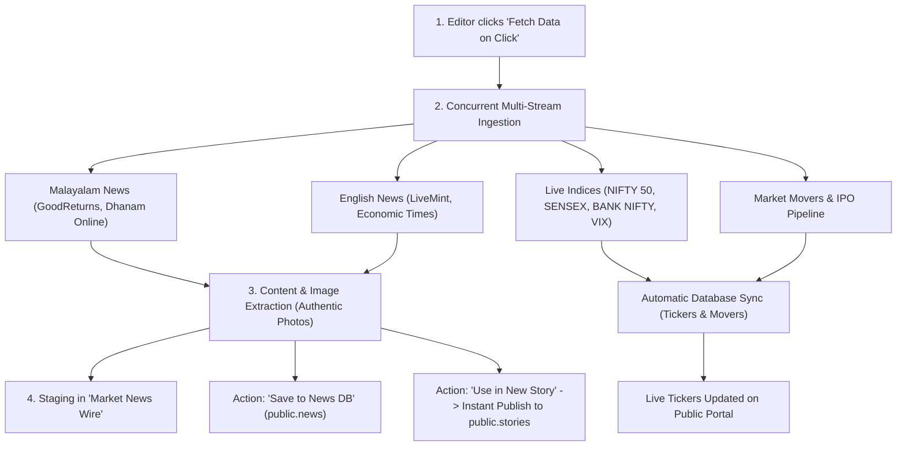

# Financial Intelligence Editorial Portal

[](https://react.dev/)
[](https://vitejs.dev/)
[](https://tailwindcss.com/)
[](https://www.typescriptlang.org/)
[](https://supabase.com/)
[](https://financial-editorial-portal-opal.vercel.app)

A high-coverage, multilingual financial journalism and real-time market intelligence portal. Built to mirror the exact user experience, desktop 3-column layout, mobile hierarchy, and market desk of [Hedge Ohari](https://hedgeohari.com), powered by a 100% free unlimited financial data engine, Razorpay payment gateway, IAB-standard advertisement engine, subscriber authentication, and Supabase PostgreSQL.

---

## 🌐 Live URLs

* **Production Site:** [https://financial-editorial-portal-opal.vercel.app](https://financial-editorial-portal-opal.vercel.app)
* **Direct Deployment URL:** [https://financial-editorial-portal-607hb4z36-knsudharsan2003s-projects.vercel.app](https://financial-editorial-portal-607hb4z36-knsudharsan2003s-projects.vercel.app)
* **GitHub Repository:** [https://github.com/sudharsankn/financial-editorial-portal](https://github.com/sudharsankn/financial-editorial-portal)
* **Local Development:** [http://localhost:3000](http://localhost:3000)
* **Admin Studio:** [http://localhost:3000/admin](http://localhost:3000/admin) *(or click Admin in the top navbar)*

---

## 🚀 Key Features

* **Exact Hedge Ohari Replication:**
  * **Desktop 3-Column Layout:** Left Category & Find Stories Sidebar, Center News Grid + Market Pulse Desk, Right Subscription Box & Quick Actions.
  * **Dual-Line Market Ticker:** Top header features speed controls and real-time scrolling tape for NIFTY 50, SENSEX, BANK NIFTY, INDIA VIX, and upcoming IPO alerts.
  * **Mobile-First UX Hierarchy:** Optimized for mobile screens with Market Pulse Header first, swipeable Top Movers carousel with Prev/Next buttons, minimizable Find Stories filter, and categorized story listings.
* **Multilingual Editorial Platform (Malayalam Primary):**
  * **Malayalam (`മലയാളം`)** is selected as the primary default language with authentic regional coverage.
  * Native Unicode grapheme segmentation (`Intl.Segmenter`) ensures strict $\le 70$ grapheme character constraints for headlines.
* **100% Free Unlimited Market Data Engine:**
  * Zero third-party subscription costs or monthly API request caps.
  * Concurrent real-time ingestion of live NSE/BSE quotes, top gainers, top losers, upcoming IPOs, and wire dispatches.
* **IAB-Standard Advertisements & Sponsorships Manager:**
  * Native ad slots matching standard IAB positions: `Full Story - Solo Position`, `Box Listing - Position 6`, `Sidebar - Left`, and `Sidebar - Right`.
  * Support for Display image banners and Video ad creatives.
  * Admin campaign manager with start/end date pickers, auto-calculated duration and total cost, live image preview, Supabase bucket media imports, and table pagination.
  * Automatic "Expired" status calculation for ended campaigns without database mutation.
  * Soft delete to Trash with 1-click campaign restoration and permanent purge.
* **Timestamped Ad Click Analytics (`public.ad_clicks`):**
  * Real-time click tracking mapped to `advertisement_id` and `campaign_id`.
  * Captures `page_url`, `referrer`, `user_agent`, and UTC click timestamp.
  * Interactive "Click Logs & Timestamps" modal in Admin Ads Manager.
* **User Authentication & Subscriber Dashboard (`public.subscribers`):**
  * Secure sign-up, sign-in, and password management with SHA-256 password hashing.
  * Dedicated "My Account" dashboard displaying active plan, subscriber code, and profile metadata.
  * Forgot/Reset password workflow.
* **Subscription Management & Razorpay Gateway (`public.subscriptions`):**
  * Integrated Razorpay payment gateway with serverless order creation and HMAC-SHA256 signature verification.
  * Transparent sandbox simulator fallback for zero-downtime test environments.
  * Tiered plans: Monthly (₹149), Quarterly (₹399), Annual (₹1,199), and Lifetime Patron.
* **Paywall & Enhanced Reading Experience:**
  * Subscriber paywall for exclusive investment insights with teaser content and locked article view.
  * Reader font size controls (Small, Medium, Large, Extra Large).
  * Reading progress bar dynamically tracking scroll depth on story details.
  * Previous & Next story navigation links.
  * Rich multi-platform social share modal (WhatsApp, Facebook, X/Twitter, LinkedIn, Telegram, Email).
* **Authentic Publisher News Photos:**
  * Automated extraction of original publisher photography from wire enclosures and OpenGraph tags, eliminating generic placeholders.
* **Static Company Pages & Contact Inquiries (`public.contact_inquiries`):**
  * Native pages for About Us (`/about-us`), Contact Us (`/contact-us`), Terms of Use (`/terms`), and Privacy Policy (`/privacy`).
  * Functional Contact Us form persisting inquiries directly to Supabase.
* **Real-Time Bookmark System:**
  * Persistent synchronization with browser `localStorage`.
  * Real-time counter badge on the navbar (`#btn-navbar-bookmarks`).

---

## 🛠️ Tech Stack

| Layer | Technology | Details |
| :--- | :--- | :--- |
| **Frontend** | React 19 + TypeScript | Strict-mode typing, hooks, and clean state synchronization |
| **Bundler & Dev Server** | Vite 6 | Lightning-fast HMR and ESM bundling |
| **Styling** | Tailwind CSS v4 | Clean utility styles with `@tailwindcss/vite` |
| **Icons** | Lucide React | High-performance SVG icons |
| **Database** | Supabase (PostgreSQL) | Relational persistence, RLS policies, and UTF-8 collation |
| **Media Storage** | Supabase Storage | `story-images` public bucket for article photos and ad banners |
| **Payments** | Razorpay SDK | Unified payment gateway with HMAC-SHA256 signature verification |
| **Market Engine** | Financial Wire + Yahoo Finance | Free unlimited feeds with zero rate-limit constraints |
| **Deployment** | Vercel | Production edge hosting with SPA rewrite routing |

---

## 🗄️ Database Schema (Supabase PostgreSQL)

The portal relies on a set of 11 relational PostgreSQL tables and 1 public storage bucket hosted on Supabase (`https://yfsgudewhwialobsyrpg.supabase.co`), configured with Row Level Security (RLS) and UTF-8 multilingual collation.

### Database Tables Overview

| Table Name | Purpose | Primary Key | Key Relationships |
| :--- | :--- | :--- | :--- |
| [`public.stories`](#1-publicstories) | Editorial articles and journalism | `id (UUID)` | Primary content store |
| [`public.advertisements`](#2-publicadvertisements) | IAB ad campaigns and banners | `id (UUID)` | `campaign_id (UNIQUE)` |
| [`public.ad_clicks`](#3-publicad_clicks) | Real-time click timestamps and logs | `id (UUID)` | Maps to `advertisements.id` / `campaign_id` |
| [`public.subscribers`](#4-publicsubscribers) | User authentication and accounts | `id (UUID)` | Parent to `subscriptions.subscriber_id` |
| [`public.subscriptions`](#5-publicsubscriptions) | Paid plans and Razorpay transactions | `id (UUID)` | `subscriber_id -> subscribers.id` (CASCADE) |
| [`public.market_tickers`](#6-publicmarket_tickers) | Header scrolling ticker tape symbols | `id (UUID)` | Active marquee feed |
| [`public.trending_stocks`](#7-publictrending_stocks) | Live Top Gainers & Losers | `id (UUID)` | Real-time market desk |
| [`public.ipos`](#8-publicipos) | Mainboard & SME IPO pipeline | `id (UUID)` | IPO Watch section |
| [`public.news`](#9-publicnews) | Raw wire news dispatches | `id (UUID)` | Staging for new stories |
| [`public.indian_stock_data`](#10-publicindian_stock_data) | Cached market data payloads | `id (UUID)` | JSONB endpoint cache |
| [`public.contact_inquiries`](#11-publiccontact_inquiries) | Submissions from Contact Us page | `id (UUID)` | Reader inquiries |

---

### Detailed Table Schemas

#### 1. `public.stories`
Stores all published, drafted, and scheduled editorial articles.
```sql
CREATE TABLE public.stories (
  id UUID PRIMARY KEY DEFAULT gen_random_uuid(),
  section TEXT NOT NULL CHECK (section IN ('Investment Insights', 'Market News', 'Special Coverage', 'IPO Watch')),
  category TEXT NOT NULL,
  heading VARCHAR(70) NOT NULL,
  lead_image_url TEXT,
  short_description TEXT,
  full_story TEXT,
  canonical_url TEXT NOT NULL UNIQUE,
  keywords TEXT,
  seo_title TEXT,
  seo_description TEXT,
  publishing_status TEXT NOT NULL DEFAULT 'Draft' CHECK (publishing_status IN ('Draft', 'Ready to Publish', 'Published', 'Retired')),
  notification_status TEXT NOT NULL DEFAULT 'No' CHECK (notification_status IN ('Yes', 'No')),
  display_order INTEGER NOT NULL DEFAULT 0,
  created_at TIMESTAMPTZ NOT NULL DEFAULT timezone('utc'::text, now()),
  updated_at TIMESTAMPTZ NOT NULL DEFAULT timezone('utc'::text, now())
);
```
* **Indexes:** `idx_stories_canonical_url` (UNIQUE), `idx_stories_publishing_status`, `idx_stories_section`, `idx_stories_category`, `idx_stories_feed_ordering (display_order ASC, created_at DESC)`.
* **Triggers:** Automatic `updated_at` refresh via `handle_updated_at()`.
* **RLS Policies:** Public `SELECT` allowed for `publishing_status = 'Published'`; full CRUD for authenticated/editorial staff.

#### 2. `public.advertisements`
Manages IAB-standard banner and video advertising campaigns across the portal.
```sql
CREATE TABLE public.advertisements (
  id UUID PRIMARY KEY DEFAULT gen_random_uuid(),
  campaign_id TEXT UNIQUE NOT NULL,
  advertiser TEXT NOT NULL,
  brand TEXT NOT NULL,
  ad_position TEXT NOT NULL CHECK (ad_position IN ('Full Story - Solo Position', 'Box Listing - Position 6', 'Sidebar - Left', 'Sidebar - Right')),
  ad_type TEXT NOT NULL DEFAULT 'Display' CHECK (ad_type IN ('Display', 'Video')),
  is_active BOOLEAN NOT NULL DEFAULT true,
  is_deleted BOOLEAN NOT NULL DEFAULT false,
  deleted_at TIMESTAMPTZ,
  display_ad_material TEXT NOT NULL,
  display_ad_url TEXT NOT NULL,
  video_ad_material TEXT,
  start_date DATE NOT NULL DEFAULT CURRENT_DATE,
  end_date DATE NOT NULL DEFAULT (CURRENT_DATE + INTERVAL '30 days'),
  cost_per_day NUMERIC NOT NULL DEFAULT 0,
  number_of_days INTEGER NOT NULL DEFAULT 30,
  total_cost NUMERIC NOT NULL DEFAULT 0,
  impressions_count BIGINT NOT NULL DEFAULT 0,
  clicks_count BIGINT NOT NULL DEFAULT 0,
  created_at TIMESTAMPTZ NOT NULL DEFAULT timezone('utc'::text, now()),
  updated_at TIMESTAMPTZ NOT NULL DEFAULT timezone('utc'::text, now())
);
```
* **Indexes:** `idx_ads_campaign_id` (UNIQUE), `idx_ads_position_active (ad_position, is_active)`.
* **Soft Delete:** Filtered via `is_deleted = false`; campaigns can be moved to Trash and restored.

#### 3. `public.ad_clicks`
Logs individual click events with high-resolution metadata for audit trails and billing verification.
```sql
CREATE TABLE public.ad_clicks (
  id UUID PRIMARY KEY DEFAULT gen_random_uuid(),
  advertisement_id TEXT,
  campaign_id TEXT NOT NULL,
  page_url TEXT,
  referrer TEXT,
  user_agent TEXT,
  clicked_at TIMESTAMPTZ NOT NULL DEFAULT timezone('utc'::text, now()),
  created_at TIMESTAMPTZ NOT NULL DEFAULT timezone('utc'::text, now())
);
```
* **Indexes:** `idx_ad_clicks_campaign`, `idx_ad_clicks_ad_id`, `idx_ad_clicks_time (clicked_at DESC)`.
* **RLS Policies:** Public `INSERT` with `WITH CHECK (true)` to record anonymous reader clicks; read access enabled.

#### 4. `public.subscribers`
User accounts, authentication credentials, and membership profiles.
```sql
CREATE TABLE public.subscribers (
  id UUID PRIMARY KEY DEFAULT gen_random_uuid(),
  email TEXT NOT NULL UNIQUE,
  password_hash TEXT NOT NULL,
  name TEXT NOT NULL,
  mobile TEXT,
  profession TEXT DEFAULT 'Investor / Financial Planner',
  state TEXT DEFAULT 'Kerala',
  created_at TIMESTAMPTZ NOT NULL DEFAULT timezone('utc'::text, now()),
  updated_at TIMESTAMPTZ NOT NULL DEFAULT timezone('utc'::text, now())
);
```
* **Indexes:** `idx_subscribers_email` (UNIQUE).
* **Security:** Password stored exclusively as cryptographically salted/hashed digests; no plaintext passwords.

#### 5. `public.subscriptions`
Stores subscription purchases, Razorpay transaction links, validity periods, and membership tiers.
```sql
CREATE TABLE public.subscriptions (
  id UUID PRIMARY KEY DEFAULT gen_random_uuid(),
  subscriber_id UUID REFERENCES public.subscribers(id) ON DELETE CASCADE,
  subscriber_code TEXT NOT NULL UNIQUE,
  plan_id TEXT NOT NULL,
  plan_title TEXT NOT NULL,
  plan_duration TEXT NOT NULL,
  amount_paid NUMERIC NOT NULL,
  currency TEXT NOT NULL DEFAULT 'INR',
  payment_method TEXT NOT NULL DEFAULT 'RAZORPAY',
  payment_id TEXT,
  order_id TEXT,
  status TEXT NOT NULL DEFAULT 'active' CHECK (status IN ('active', 'expired', 'cancelled')),
  starts_at TIMESTAMPTZ NOT NULL DEFAULT timezone('utc'::text, now()),
  expires_at TIMESTAMPTZ NOT NULL,
  created_at TIMESTAMPTZ NOT NULL DEFAULT timezone('utc'::text, now())
);
```
* **Indexes:** `idx_subscriptions_code` (UNIQUE), `idx_subscriptions_subscriber`, `idx_subscriptions_status`.

#### 6. `public.market_tickers`
Configurable market ticker items scrolling across the top header ribbon.
```sql
CREATE TABLE public.market_tickers (
  id UUID PRIMARY KEY DEFAULT gen_random_uuid(),
  symbol TEXT NOT NULL,
  price TEXT NOT NULL,
  change TEXT NOT NULL,
  is_positive BOOLEAN NOT NULL DEFAULT true,
  display_order INTEGER NOT NULL DEFAULT 0,
  is_active BOOLEAN NOT NULL DEFAULT true,
  created_at TIMESTAMPTZ NOT NULL DEFAULT timezone('utc'::text, now()),
  updated_at TIMESTAMPTZ NOT NULL DEFAULT timezone('utc'::text, now())
);
```
* **Indexes:** `idx_market_tickers_display_order (display_order ASC, created_at ASC)`, `idx_market_tickers_is_active`.

#### 7. `public.trending_stocks`
Real-time top gainers and losers from the Indian stock market.
```sql
CREATE TABLE public.trending_stocks (
  id UUID PRIMARY KEY DEFAULT gen_random_uuid(),
  ticker_id TEXT,
  company_name TEXT NOT NULL,
  price TEXT NOT NULL,
  percent_change TEXT NOT NULL,
  net_change TEXT,
  trend_type TEXT NOT NULL CHECK (trend_type IN ('gainer', 'loser')),
  high TEXT,
  low TEXT,
  open TEXT,
  close TEXT,
  volume TEXT,
  overall_rating TEXT,
  short_term_trends TEXT,
  exchange_type TEXT DEFAULT 'BSE',
  section TEXT NOT NULL DEFAULT 'Market News',
  category TEXT NOT NULL DEFAULT 'Market Trends',
  is_published BOOLEAN NOT NULL DEFAULT true,
  display_order INTEGER NOT NULL DEFAULT 0,
  fetched_at TIMESTAMPTZ NOT NULL DEFAULT timezone('utc'::text, now()),
  created_at TIMESTAMPTZ NOT NULL DEFAULT timezone('utc'::text, now())
);
```
* **Indexes:** `idx_trending_stocks_type`, `idx_trending_stocks_published`.

#### 8. `public.ipos`
Pipeline of upcoming, ongoing, and recently listed Mainboard and SME IPOs.
```sql
CREATE TABLE public.ipos (
  id UUID PRIMARY KEY DEFAULT gen_random_uuid(),
  symbol TEXT NOT NULL,
  name TEXT NOT NULL,
  status TEXT NOT NULL DEFAULT 'upcoming' CHECK (status IN ('upcoming', 'ongoing', 'listed', 'closed')),
  is_sme BOOLEAN NOT NULL DEFAULT false,
  issue_price TEXT,
  issue_size TEXT,
  listing_date TEXT,
  open_date TEXT,
  close_date TEXT,
  gmp TEXT,
  subscription_rate TEXT,
  is_published BOOLEAN NOT NULL DEFAULT true,
  display_order INTEGER NOT NULL DEFAULT 0,
  fetched_at TIMESTAMPTZ NOT NULL DEFAULT timezone('utc'::text, now()),
  created_at TIMESTAMPTZ NOT NULL DEFAULT timezone('utc'::text, now())
);
```

#### 9. `public.news`
Saved raw news wire dispatches from RSS ingestion, available for 1-click story drafting.
```sql
CREATE TABLE public.news (
  id UUID PRIMARY KEY DEFAULT gen_random_uuid(),
  title TEXT NOT NULL,
  summary TEXT NOT NULL,
  full_content TEXT,
  image_url TEXT NOT NULL,
  url TEXT,
  source TEXT NOT NULL DEFAULT 'Market Wire',
  pub_date TEXT NOT NULL,
  category TEXT NOT NULL DEFAULT 'Market Trends',
  created_at TIMESTAMPTZ NOT NULL DEFAULT timezone('utc'::text, now())
);
```
* **Indexes:** `idx_news_created_at (created_at DESC)`.

#### 10. `public.indian_stock_data`
Structured JSONB storage for market API snapshots and raw endpoint caches.
```sql
CREATE TABLE public.indian_stock_data (
  id UUID PRIMARY KEY DEFAULT gen_random_uuid(),
  endpoint TEXT NOT NULL CHECK (endpoint IN ('trending', 'news', 'ipo', 'stock')),
  query TEXT,
  title TEXT,
  summary TEXT,
  data JSONB NOT NULL,
  fetched_at TIMESTAMPTZ NOT NULL DEFAULT timezone('utc'::text, now()),
  section TEXT NOT NULL DEFAULT 'Market News',
  category TEXT NOT NULL DEFAULT 'Market Trends',
  is_published BOOLEAN NOT NULL DEFAULT false,
  display_order INTEGER NOT NULL DEFAULT 0,
  created_at TIMESTAMPTZ NOT NULL DEFAULT timezone('utc'::text, now()),
  updated_at TIMESTAMPTZ NOT NULL DEFAULT timezone('utc'::text, now())
);
```
* **Indexes:** `idx_indian_stock_data_endpoint`, `idx_indian_stock_data_is_published`, `idx_indian_stock_data_fetched_at`.

#### 11. `public.contact_inquiries`
Stores inquiries and feedback submitted via the Contact Us page form.
```sql
CREATE TABLE public.contact_inquiries (
  id UUID PRIMARY KEY DEFAULT gen_random_uuid(),
  name TEXT NOT NULL,
  email TEXT NOT NULL,
  mobile TEXT,
  subject TEXT,
  message TEXT NOT NULL,
  created_at TIMESTAMPTZ NOT NULL DEFAULT timezone('utc'::text, now())
);
```

#### Storage Bucket: `story-images`
Public Supabase Storage bucket (`storage.buckets`) configured for binary media assets:
* **Max file size limit:** 5 MB (5,242,880 bytes).
* **Allowed MIME types:** `image/jpeg`, `image/png`, `image/webp`, `image/jpg`.
* **Public Access Policy:** Read-only access enabled for public; write access enabled for editors.

---

## ⚡ Step-by-Step: How to Run Locally

### 1. Prerequisites
* **Node.js**: v18.0.0 or higher
* **npm** or **pnpm** installed
* A **Supabase** project (configured credentials provided in `.env`)

### 2. Clone the Repository
```bash
git clone https://github.com/sudharsankn/financial-editorial-portal.git
cd financial-editorial-portal
```

### 3. Install Dependencies
```bash
npm install
```

### 4. Configure Environment Variables
Create a `.env` file in the root directory (or use `.env.example` as a template):

```env
# Supabase Configuration (Vite Dev & Production)
VITE_SUPABASE_URL="https://yfsgudewhwialobsyrpg.supabase.co"
VITE_SUPABASE_ANON_KEY="sb_publishable_RcksFD4-e-ujGBtSDnE6Iw_VVEnOAU1"

# Supabase Configuration (Next.js / Vercel Edge SSR)
NEXT_PUBLIC_SUPABASE_URL="https://yfsgudewhwialobsyrpg.supabase.co"
NEXT_PUBLIC_SUPABASE_ANON_KEY="sb_publishable_RcksFD4-e-ujGBtSDnE6Iw_VVEnOAU1"

# Application Host URL
APP_URL="http://localhost:3000"

# Razorpay Payment Gateway Credentials
VITE_RAZORPAY_KEY_ID="rzp_test_9oy85KnsbS2V4P"
RAZORPAY_KEY_ID="rzp_test_9oy85KnsbS2V4P"
RAZORPAY_KEY_SECRET="SGNSZk9HMDxeYzR4xnT6lsoP"
```

### 5. Start the Development Server
```bash
npm run dev
```
Open your browser and navigate to:
* **Public Portal:** `http://localhost:3000`
* **Admin Studio:** `http://localhost:3000/admin`
* **Ad Manager:** `http://localhost:3000/admin` -> Advertisements tab
* **Contact Us:** `http://localhost:3000/contact-us`
* **Subscription Pricing:** `http://localhost:3000/subscribe`

### 6. Build for Production
```bash
npm run build
```
The optimized production bundle will be generated in the `dist/` directory.

---

## 🔄 Step-by-Step: How "Fetch Data on Click" Works

The **"Fetch Data on Click"** feature allows editors to pull live market data, trending movers, IPOs, and multilingual news with a single click.



### Step 1: User Initiation
1. Open the Admin Studio at `/admin`.
2. Select the **Market News Wire** tab.
3. Click the purple button **"Fetch Data on Click"** (`#btn-fetch-unified-data`).

### Step 2: Concurrent Multi-Source Ingestion
The engine executes parallel asynchronous calls across multiple financial sources:
* **Malayalam Financial Wire:** GoodReturns Malayalam and Dhanam Online.
* **English Financial Wire:** LiveMint Markets and The Economic Times.
* **Market Indices:** Real-time data for NIFTY 50, SENSEX, BANK NIFTY, and INDIA VIX.
* **Market Movers & IPOs:** Top 10 Gainers, Top 10 Losers, and upcoming Mainboard/SME IPOs.

### Step 3: Smart Extraction & Language Detection
* **Authentic Lead Images:** Automatically parses original `<enclosure>`, `<media:content>`, or high-res image tags.
* **Unicode Script Classification:** Detects Malayalam characters (`[\u0D00-\u0D7F]`) to prioritize Malayalam stories.
* **SEO Metadata:** Generates canonical slugs, summaries, and keyword tags automatically.

### Step 4: Staging for Editorial Review
* Live indices and movers update the public ticker immediately.
* Incoming news dispatches are placed in the **Market News Wire** staging view for review, ensuring unvetted content is never published without editorial sign-off.

### Step 5: 1-Click Publishing
On any item in the staging wire, editors can:
1. Click **"Use in New Story"**: Opens the Story Editor with the headline, authentic image, complete article body, category, and SEO slug pre-filled.
2. Select **"Publish"** and click **"Save Story"**: The article is published to the public portal and stored in Supabase `public.stories`.

---

## ✍️ Editorial & Admin Guide

### Accessing Admin Mode
1. Click the **Admin** button in the header or visit `/admin`.
2. The Admin Studio contains four primary tabs:
   * **Market News Wire:** Real-time news ingest, language filters, and 1-click story drafting.
   * **Stories Manager:** Full lifecycle management (`Draft`, `Ready to Publish`, `Published`, `Retired`) with live grapheme validation.
   * **Advertisements:** IAB campaign manager, duration & cost calculation, image uploads, soft delete, and click logs.
   * **Live Markets Studio:** Manage top scrolling ticker symbols and price changes.

### Publishing a New Story
1. Click **"+ Create New Story"**.
2. Fill in the fields:
   * **Section:** Choose from *Investment Insights*, *Market News*, *Special Coverage*, or *IPO Watch*.
   * **Category:** *Financial Planning*, *Big Story*, *Market Trends*, *Stock Recommendations*, *Commodities*, *Banking & Finance*, etc.
   * **Heading:** Up to 70 graphemes / characters (supports full Malayalam Unicode).
   * **Lead Image URL:** Direct URL to a 560x320 JPG/PNG or Supabase storage image.
   * **Short Description & Full Story:** Rich HTML or plain text content.
   * **Canonical URL Slug:** e.g. `lic-share-price-drops-after-jefferies-cuts-target-price`.
3. Set status to **"Published"** and click **"Save Story"**.

---

## 🚢 Deployment (Vercel)

The repository includes a [`vercel.json`](file:///d:/financial-editorial-portal/vercel.json) file preconfigured for single-page application (SPA) routing:

```json
{
  "rewrites": [
    {
      "source": "/(.*)",
      "destination": "/index.html"
    }
  ]
}
```

### Deploying Updates
```bash
# Push commits to GitHub
git push origin main

# Deploy to Preview
npx vercel

# Deploy directly to Production
npx vercel --prod
```

---

## 📜 Available NPM Scripts

* `npm run dev`: Starts the local development server at `http://localhost:3000`.
* `npm run build`: Type-checks and creates an optimized production bundle in `dist/`.
* `npm run preview`: Locally previews the production build.
* `npm run lint`: Runs TypeScript validation (`tsc --noEmit`).

---

## 📄 License
This project is proprietary and built for financial intelligence editorial operations.
