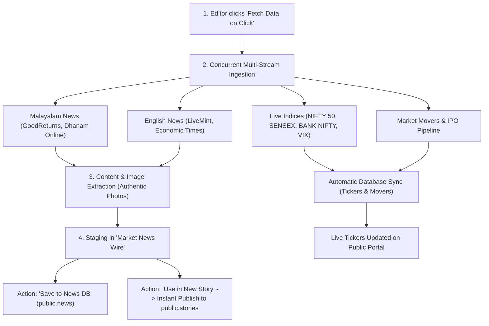

# Financial Intelligence Editorial Portal

[](https://react.dev/)
[](https://vitejs.dev/)
[](https://tailwindcss.com/)
[](https://www.typescriptlang.org/)
[](https://supabase.com/)
[](https://financial-editorial-portal-opal.vercel.app)

A high-coverage, multilingual financial journalism and real-time market intelligence portal. Built to mirror the exact user experience, desktop 3-column layout, mobile hierarchy, and market desk of [Hedge Ohari](https://hedgeohari.com), powered by a 100% free unlimited financial data engine and Supabase PostgreSQL.

---

## 🌐 Live URLs

* **Production Site:** [https://financial-editorial-portal-opal.vercel.app](https://financial-editorial-portal-opal.vercel.app)
* **Direct Deployment URL:** [https://financial-editorial-portal-jxl7spp0z-knsudharsan2003s-projects.vercel.app](https://financial-editorial-portal-jxl7spp0z-knsudharsan2003s-projects.vercel.app)
* **Local Development:** [http://localhost:3000](http://localhost:3000)
* **Admin Studio:** [http://localhost:3000/admin](http://localhost:3000/admin) *(or click Admin in the top navbar)*

---

## 🚀 Key Features

* **Exact Hedge Ohari Replication:**
  * **Desktop 3-Column Layout:** Left Category & Find Stories Sidebar, Center News Grid + Market Pulse Desk, Right Subscription Box & Quick Actions.
  * **Dual-Line Market Ticker:** Top header features speed controls and real-time scrolling tape for NIFTY 50, SENSEX, BANK NIFTY, INDIA VIX, and upcoming IPO alerts.
  * **Mobile-First UX Hierarchy:** Optimized for mobile phones with Market Pulse Header first, swipeable Top Movers carousel with Prev/Next buttons, minimizable Find Stories filter, and categorized story listings.
* **Multilingual Editorial Platform (Malayalam Primary):**
  * **Malayalam (`മലയാളം`)** is selected as the primary default language with authentic regional coverage.
  * Automatic Unicode script detection (`Intl.Segmenter`) ensures seamless rendering for both Malayalam and English.
* **100% Free Unlimited Market Data Engine:**
  * Zero third-party subscription costs or monthly API request caps.
  * Concurrent real-time ingestion of live NSE/BSE quotes, top gainers, top losers, upcoming IPOs, and wire dispatches.
* **Authentic Publisher News Photos:**
  * Automated extraction of original publisher photography from wire enclosures and OpenGraph tags, eliminating generic Unsplash placeholders.
* **Real-Time Bookmark System:**
  * Persistent synchronization with `localStorage`.
  * Real-time counter badge on the navbar (`#btn-navbar-bookmarks`).
  * One-click toggle displaying saved bookmarks with an active filter banner and empty-state guidance.
* **Comprehensive Admin Studio (`/admin`):**
  * **Market News Wire:** 1-click fetch, preview, and story conversion.
  * **Stories Manager:** Full editorial CRUD with grapheme character limits, rich HTML editing, and canonical slug generation.
  * **Live Markets Studio:** Manage live indices, movers, and IPO pipelines.

---

## 🛠️ Tech Stack

| Layer | Technology | Details |
| :--- | :--- | :--- |
| **Frontend** | React 19 + TypeScript | Strict-mode typing, hooks, and clean state synchronization |
| **Bundler & Dev Server** | Vite 6 | Lightning-fast HMR and ESM bundling |
| **Styling** | Tailwind CSS v4 | Clean utility styles with `@tailwindcss/vite` |
| **Icons** | Lucide React | High-performance SVG icons |
| **Database** | Supabase (PostgreSQL) | Persistence for stories, raw news, tickers, movers, and IPOs |
| **Market Engine** | Financial Wire + Yahoo Finance | Free unlimited feeds with zero rate-limit constraints |
| **Deployment** | Vercel | Production edge hosting with SPA routing |

---

## ⚡ Step-by-Step: How to Run Locally

### 1. Prerequisites
* **Node.js**: v18.0.0 or higher
* **npm** or **pnpm** installed
* A **Supabase** project (or use the configured default credentials)

### 2. Clone the Repository
```bash
git clone https://github.com/sudharsankn/financial-editorial-portal.git
cd financial-editorial-portal
```

### 3. Install Dependencies
```bash
npm install
```

### 4. Configure Environment Variables
Create a `.env` file in the root directory (or use `.env.example` as a template):

```env
# Supabase Configuration
VITE_SUPABASE_URL="https://yfsgudewhwialobsyrpg.supabase.co"
VITE_SUPABASE_ANON_KEY="sb_publishable_RcksFD4-e-ujGBtSDnE6Iw_VVEnOAU1"
NEXT_PUBLIC_SUPABASE_URL="https://yfsgudewhwialobsyrpg.supabase.co"
NEXT_PUBLIC_SUPABASE_ANON_KEY="sb_publishable_RcksFD4-e-ujGBtSDnE6Iw_VVEnOAU1"

# Application URL
APP_URL="http://localhost:3000"
```

### 5. Start the Development Server
```bash
npm run dev
```
Open your browser and navigate to:
* **Public Portal:** `http://localhost:3000`
* **Admin Studio:** `http://localhost:3000/admin`

### 6. Build for Production
```bash
npm run build
```
The optimized production bundle will be generated in the `dist/` directory.

---

## 🔄 Step-by-Step: How "Fetch Data on Click" Works

The **"Fetch Data on Click"** feature allows editors to pull live market data, trending movers, IPOs, and multilingual news with a single click.



### Step 1: User Initiation
1. Open the Admin Studio at `/admin`.
2. Select the **Market News Wire** tab.
3. Click the purple button **"Fetch Data on Click"** (`#btn-fetch-unified-data`).

### Step 2: Concurrent Multi-Source Ingestion
The engine executes parallel asynchronous calls across multiple financial sources:
* **Malayalam Financial Wire:** GoodReturns Malayalam and Dhanam Online.
* **English Financial Wire:** LiveMint Markets and The Economic Times.
* **Market Indices:** Real-time data for NIFTY 50, SENSEX, BANK NIFTY, and INDIA VIX.
* **Market Movers & IPOs:** Top 10 Gainers, Top 10 Losers, and upcoming Mainboard/SME IPOs.

### Step 3: Smart Extraction & Language Detection
* **Authentic Lead Images:** Automatically parses original `<enclosure>`, `<media:content>`, or high-res image tags.
* **Unicode Script Classification:** Detects Malayalam characters (`[\u0D00-\u0D7F]`) to prioritize Malayalam stories.
* **SEO Metadata:** Generates canonical slugs, summaries, and keyword tags automatically.

### Step 4: Staging for Editorial Review
* Live indices and movers update the public ticker immediately.
* Incoming news dispatches are placed in the **Market News Wire** staging view for review, ensuring unvetted content is never published without editorial sign-off.

### Step 5: 1-Click Publishing
On any item in the staging wire, editors can:
1. Click **"Use in New Story"**: Opens the Story Editor with the headline, authentic image, complete article body, category, and SEO slug pre-filled.
2. Select **"Publish"** and click **"Save Story"**: The article is published to the public portal and stored in Supabase `public.stories`.

---

## ✍️ Editorial & Admin Guide

### Accessing Admin Mode
1. Click the **Admin** button in the header or visit `/admin`.
2. The Admin Studio contains three primary tabs:
   * **Market News Wire:** Real-time news ingest and 1-click story drafting.
   * **Stories Manager:** Full lifecycle management (Draft, Ready to Publish, Published, Retired).
   * **Live Markets Studio:** Manage top scrolling ticker symbols and price changes.

### Publishing a New Story
1. Click **"+ Create New Story"**.
2. Fill in the fields:
   * **Section:** Choose from *Investment Insights*, *Market News*, or *Special Coverage*.
   * **Category:** *Financial Planning*, *Big Story*, *Market Trends*, *Stock Recommendations*, *IPO Pipeline*, etc.
   * **Heading:** Up to 70 grapheme characters (supports full Malayalam Unicode).
   * **Lead Image URL:** Direct URL to a 560x320 JPG/PNG.
   * **Short Description & Full Story:** Rich HTML or plain text content.
   * **Canonical URL Slug:** e.g. `nifty-crosses-25000-all-time-high`.
3. Set status to **"Published"** and click **"Save Story"**.

---

## 🗄️ Database Schema (Supabase PostgreSQL)

| Table | Purpose | Key Columns |
| :--- | :--- | :--- |
| `public.stories` | Published & drafted articles | `id`, `section`, `category`, `heading`, `lead_image_url`, `short_description`, `full_story`, `canonical_url`, `publishing_status`, `display_order`, `published_at` |
| `public.news` | Saved raw wire dispatches | `id`, `title`, `summary`, `full_content`, `image_url`, `source`, `category`, `pub_date` |
| `public.market_tickers` | Ticker tape quotes | `id`, `symbol`, `price`, `change`, `is_positive`, `display_order`, `is_active` |
| `public.trending_stocks` | Top Gainers & Losers | `id`, `ticker_id`, `company_name`, `price`, `percent_change`, `trend_type`, `volume` |
| `public.ipos` | Upcoming & active IPOs | `id`, `symbol`, `company_name`, `price_range`, `status`, `open_date`, `close_date` |

---

## 🚢 Deployment (Vercel)

The repository includes a [`vercel.json`](file:///d:/financial-editorial-portal/vercel.json) file preconfigured for single-page application (SPA) routing:

```json
{
  "rewrites": [
    {
      "source": "/(.*)",
      "destination": "/index.html"
    }
  ]
}
```

### Deploying Updates
```bash
# Deploy to Preview
npx vercel

# Deploy directly to Production
npx vercel --prod
```

---

## 📜 Available NPM Scripts

* `npm run dev`: Starts the local development server at `http://localhost:3000`.
* `npm run build`: Type-checks and creates an optimized production build in `dist/`.
* `npm run preview`: Locally previews the production build.
* `npm run lint`: Runs TypeScript validation (`tsc --noEmit`).

---

## 📄 License
This project is proprietary and built for financial intelligence editorial operations.

